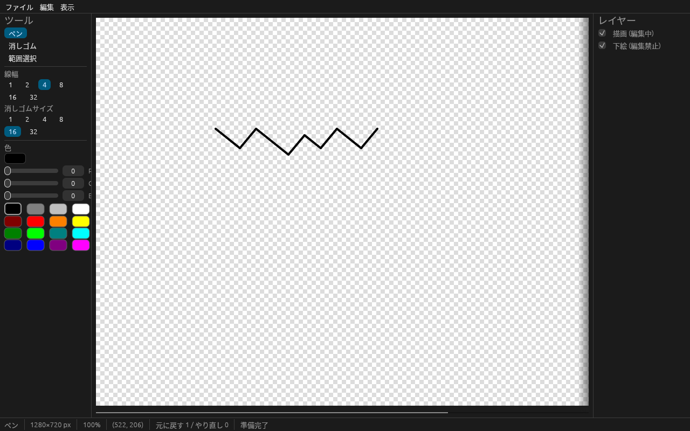
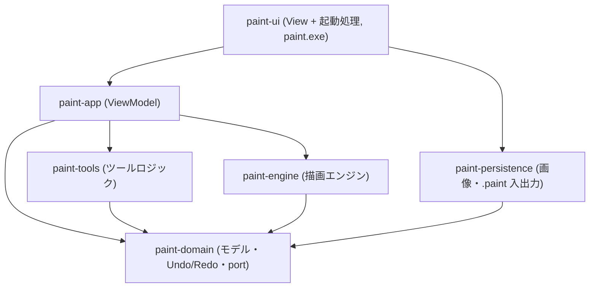

# Rust Paint (2026_11_10_Rust_GUI_on_windows)

Windows 10 / 11 (64bit) 向けのお絵描きソフトです。Rust + [egui / eframe](https://github.com/emilk/egui) で作られた単体実行できる exe です。

## 主な機能

- 下絵: PNG / JPEG / BMP を読み込み、編集禁止のレイヤーとしてキャンバス背景に表示
- 描画: ペン (自由線・クリックで点・Shift で直線)、直線ツール (始点→終点)、線幅 1 / 2 / 4 / 8 / 16 / 32 px、RGB 指定 + カラーパレット
- テキスト: キャンバスをクリックして入力 (日本語 IME 対応、英語・日本語・中国語・韓国語・欧文)、文字サイズは数値入力 (8〜400 px)、インストール済みフォントから選択
- 消しゴム: ドラッグで消去 (サイズ指定)、矩形選択 + Delete で範囲消去
- レイヤー: 下絵 (編集禁止) + 描画 (編集可)。表示の切替
- Undo / Redo: それぞれ 100 回
- 保存: 独自形式 `.paint` (レイヤー・描画内容・色・線幅・キャンバスサイズ)、PNG / 透過 PNG 書き出し
- ズーム (10%〜3200%、Ctrl+マウスホイール) とスクロール

操作方法は [docs/UserManual.md](docs/UserManual.md) を参照してください。

## ビルド方法

必要なもの: [Rust](https://rustup.rs/) stable (1.95 以上)。Windows では Visual Studio Build Tools (C++ によるデスクトップ開発) も必要です。

```powershell
cargo build --release --locked
```

`target\release\paint.exe` が生成されます。C ランタイムを静的リンクしているため、この exe 1 つをコピーするだけで動作します。CI の成果物 (`paint-windows-x64`) からも取得できます。

## 実行方法

```powershell
cargo run --release      # またはエクスプローラーで target\release\paint.exe をダブルクリック
```

## 画面説明



| 場所 | 内容 |
|---|---|
| 上 | メニュー (ファイル / 編集 / 表示) |
| 左 | ツールパレット: ツール (ペン / 直線 / 消しゴム / 範囲選択 / テキスト)、線幅、文字サイズ・フォント (テキスト選択時)、消しゴムサイズ、色 (RGB・パレット) |
| 中央 | キャンバス (透明部分は市松模様)。はみ出す場合はスクロールバー・ホイール・中ボタンドラッグで移動 |
| 右 | レイヤーパネル: 描画 (編集中)・下絵 (編集禁止) と表示切替 |
| 下 | ステータスバー: ツール、キャンバスサイズ、倍率、カーソル座標、Undo/Redo 件数、メッセージ |

| ショートカット | 動作 |
|---|---|
| Ctrl+O | 画像 (下絵) を開く |
| Ctrl+S | 保存 (初回は保存先を選択) |
| Ctrl+Z / Ctrl+Y | 元に戻す / やり直し |
| Delete | 選択範囲を削除 |
| Esc | 選択解除 |
| Ctrl+マウスホイール | ズーム (カーソル位置が中心) |
| Shift (ドラッグ中) | 直線 |
| Shift+マウスホイール | 横スクロール |

## アーキテクチャ

MVVM 準拠で、責務ごとに crate を分けています。依存の向きはコンパイラで強制され、ファイル入出力は Domain の trait (port) 経由で注入します (依存関係逆転)。



- 描画内容はラスタではなく描画操作 (`DrawOp`) の列で保持し、Undo/Redo と将来の SVG / PDF 出力に対応します
- 新しいツール・図形・出力形式は、それぞれ `paint-tools`・`DrawOp` + `paint-engine`・`paint-persistence` への追加で拡張できます

詳細: [docs/Architecture.md](docs/Architecture.md)、ファイル形式: [docs/FileFormat.md](docs/FileFormat.md)、テスト方針: [docs/TestStrategy.md](docs/TestStrategy.md)、開発計画: [docs/DevelopmentPlan.md](docs/DevelopmentPlan.md)。API ドキュメントは `cargo doc --workspace --no-deps --open` で生成できます。

## 開発ルール

- GitHub Flow: `main` から `devin/<timestamp>-<slug>` などの作業ブランチを切り、Pull Request でマージします。`main` への直接コミットは禁止です
- Issue 駆動: すべての作業は Issue に紐づけます。仕様の不明点は推測で実装せず、Issue で PO の承認を得ます
- すべての変更にテストを追加します
- CI (GitHub Actions、windows-latest / ubuntu-latest) が以下を実行し、すべて成功しないとマージしません

```powershell
cargo fmt --all -- --check
cargo clippy --workspace --all-targets --locked -- -D warnings
cargo test --workspace --locked          # Unit / Integration / E2E
cargo build --release --locked
./scripts/smoke.ps1                      # 起動 3 秒以内・メモリ 500MB 以下 (Windows)
```

## ライセンス

[MIT License](LICENSE)。依存クレートはそれぞれのライセンス (MIT / Apache-2.0 など) に従います。
