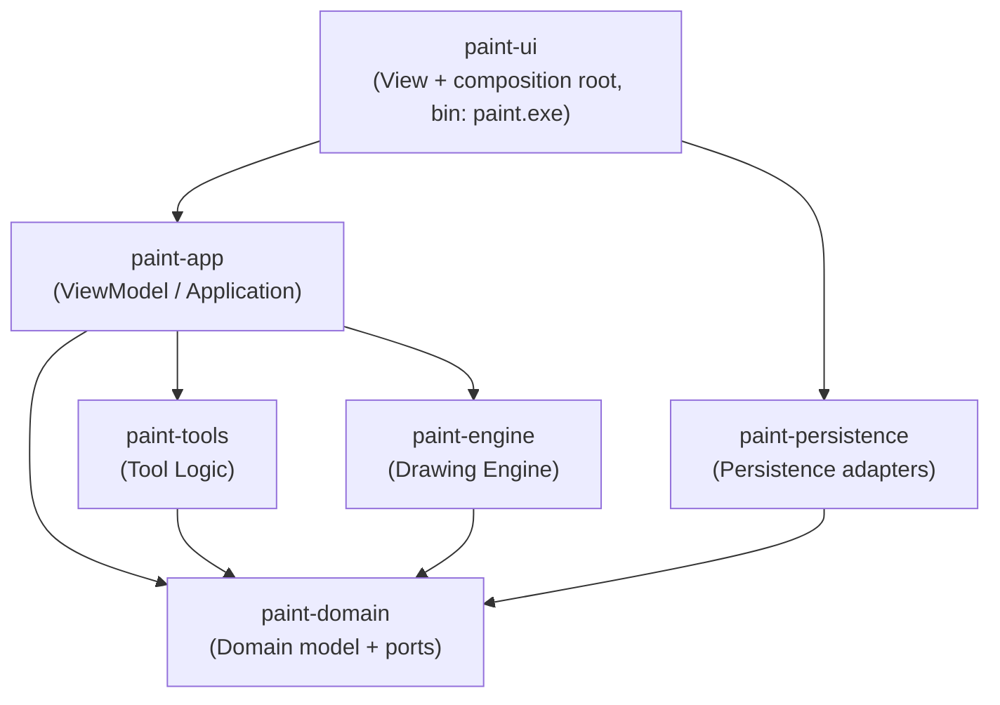
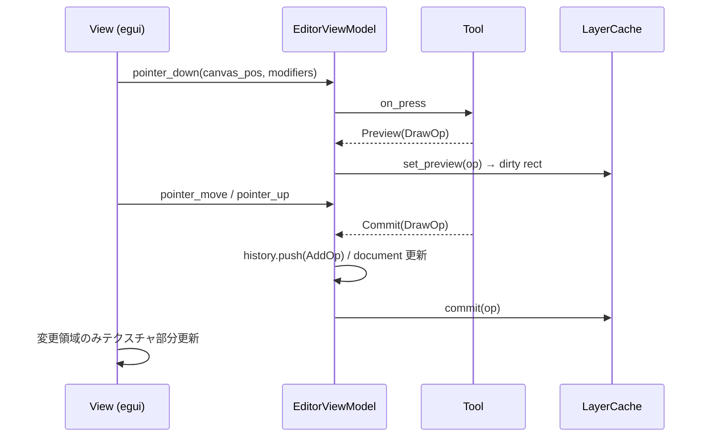

# アーキテクチャ

関連 Issue: #3

## 1. 方針

- **MVVM 準拠**: View (egui) は ViewModel の状態を描画し、ユーザー操作を ViewModel のコマンドに変換するだけ。アプリの状態・ロジックは全て GUI 非依存の crate に置き、GUI なしでテストできる
- **関心の分離**: UI / ViewModel / Tool Logic / Drawing Engine / Domain / Persistence を個別 crate に分け、依存方向をコンパイラで強制する
- **依存関係逆転 (DIP)**: ファイル入出力の抽象 (port trait) は Domain に定義し、Persistence がそれを実装する。ViewModel は trait にのみ依存し、具体実装は実行ファイル (composition root) で注入する

## 2. crate 構成と依存方向



| crate | 責務 | 外部依存 |
|---|---|---|
| `paint-domain` | 色・座標・キャンバス・レイヤー・描画操作 (`DrawOp`)・ドキュメント・Undo/Redo 履歴・入出力 port (`ProjectStore` / `ImageImporter` / `ImageExporter`) | なし (std のみ) |
| `paint-engine` | `DrawOp` のラスタライズ (アンチエイリアス付き円形ブラシ)、消去、レイヤーキャッシュ (確定バッファ + プレビューバッファ)、レイヤー合成、テキストのレイアウトとラスタライズ (スケーラブルフォント + 代替フォント) | `ab_glyph` |
| `paint-tools` | マウス入力 (押下/移動/離す + 修飾キー) を `DrawOp` や選択範囲に変換する `Tool` trait と各ツール | なし |
| `paint-persistence` | port の実装: 画像読込 (PNG/JPEG/BMP)、`.paint` 保存/読込、PNG 書き出し、システムフォント一覧/読込 (`FontSource`) | `image`, `serde`, `serde_json`, `base64`, `fontique` |
| `paint-app` | `EditorViewModel`: ドキュメント・履歴・ツール・ビューポート (ズーム/スクロール)・選択範囲・ファイル状態を管理し、UI からのコマンドを処理 | なし (port 経由) |
| `paint-ui` | eframe/egui による画面 (ツールパレット/キャンバス/レイヤーパネル/ステータスバー)、ショートカット、ファイルダイアログ、依存注入 | `eframe`, `egui`, `rfd` |

## 3. 主要な型

```text
Document
 ├─ canvas: CanvasSize
 └─ layers: Vec<Layer>             … 将来のレイヤー無制限化に備え Vec で保持
      Layer { id, name, visible, locked, content }
        content = LayerContent::Raster(Option<RasterImage>)   … 下絵 (locked = true)
                | LayerContent::Vector(Vec<DrawOp>)           … 描画レイヤー

DrawOp = Stroke { color, width, points }    … ペン / 点 / 直線
       | Erase  { width, points }           … 通常消しゴム
       | ClearRect { rect }                 … 範囲消去

History { undo: VecDeque<EditCommand>, redo: Vec<EditCommand>, limit }
EditCommand = AddOp { layer, op } | ReplaceUnderlay { before, after }
```

- 描画内容は **描画操作 (ベクタ) の列** として保持する。これにより `.paint` に色・線幅情報をそのまま保存でき、Undo は操作の取り消しだけで済み (画像スナップショット不要でメモリ効率が良い)、将来の SVG/PDF 出力にも流用できる
- 画面表示用のラスタは `paint-engine` の `LayerCache` が保持し、操作追加時は差分描画、Undo/Redo 時は再構築する

## 4. データフロー (描画 1 ストローク)



## 5. エラー処理とクラッシュ対策

- I/O・デコード失敗は `Result` で ViewModel まで返し、ステータスバー / ダイアログで通知 (アプリは継続)
- 本番コードで `unwrap` / `expect` を使用しない (clippy `unwrap_used` / `expect_used` を `warn`、CI は `-D warnings`)
- 座標はキャンバス外でもクリップして安全に処理

## 6. 拡張ポイント (今後追加予定機能)

| 将来機能 | 拡張方法 |
|---|---|
| レイヤー無制限化 | `Document.layers` は既に `Vec`。`EditCommand` にレイヤー追加/削除/並べ替えを追加し、レイヤーパネルにボタンを追加 |
| PDF / SVG 出力 | `ImageExporter` と同様の port (`DocumentExporter`) を追加。描画内容がベクタ (`DrawOp`) なので SVG パスへ直接変換可能 |
| 図形描画 | `Tool` trait を実装した新ツール + `DrawOp` に `Shape` を追加 |
| テキスト描画 | `DrawOp::Text` + テキストツール。ラスタ化は engine に追加 |
| ブラシ機能 | `Stroke` に `brush: BrushKind` を追加し、engine のスタンプ関数を差し替え |
| タブレット筆圧 | 点列を `Vec<StrokePoint { pos, pressure }>` に拡張 (ファイル形式は version で互換維持)。egui の `Touch`/pen 入力を ViewModel に渡す |
| マクロ機能 | ViewModel の公開コマンド (`EditorCommand`) が全操作を表現しているため、コマンド列の記録・再生で実現 |
| プラグイン | `Tool` / `DocumentExporter` trait をプラグイン境界とし、レジストリ (`ToolRegistry`) に登録する方式 |
